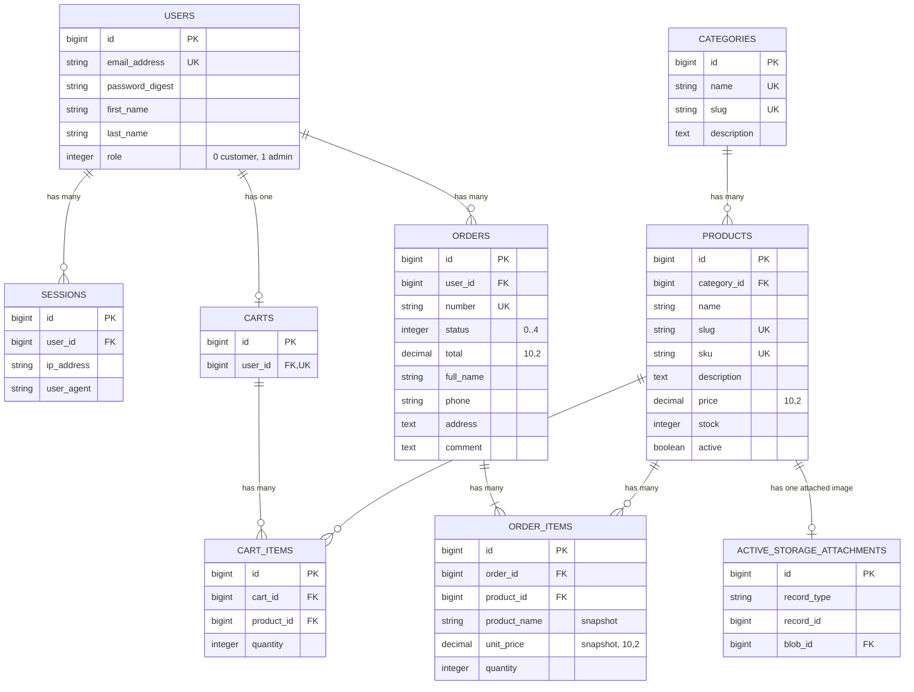
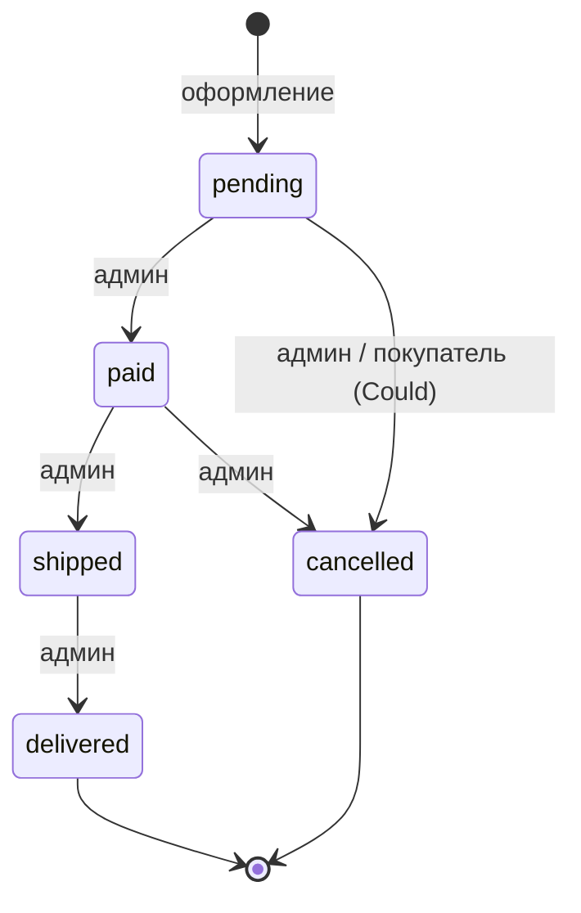

# Структура базы данных (ERD)

> СУБД: PostgreSQL. Все таблицы имеют `id bigint` (PK) и `created_at` / `updated_at` (`timestamp`, NOT NULL), если не указано иное.
> Деньги хранятся только в `decimal(10,2)`. Перечисления хранятся в `integer` и описываются через `enum` в модели.

## 1. Диаграмма



## 2. Таблицы

### 2.1. `users`
Создаётся генератором `bin/rails generate authentication`. Поля `first_name`, `last_name` и `role` добавляются отдельной миграцией.

| Поле | Тип | NULL | Default | Ограничения / индексы |
|---|---|:---:|---|---|
| id | bigint | ✗ | | PK |
| email_address | string | ✗ | | уникальный индекс |
| password_digest | string | ✗ | | bcrypt |
| first_name | string | ✗ | | |
| last_name | string | ✗ | | |
| role | integer | ✗ | `0` | индекс; check `role IN (0, 1)` |
| created_at / updated_at | timestamp | ✗ | | |

**Модель `User`:**
- `has_secure_password`
- `has_many :sessions, dependent: :destroy`
- `has_one :cart, dependent: :destroy`
- `has_many :orders, dependent: :restrict_with_error` (пользователя с заказами удалить нельзя)
- `enum :role, { customer: 0, admin: 1 }, default: :customer`
- `normalizes :email_address, with: ->(e) { e.strip.downcase }`
- Валидации: `email_address` — присутствие, формат (`URI::MailTo::EMAIL_REGEXP`), уникальность; `first_name`, `last_name` — присутствие, до 50 символов; `password` — минимум 8 символов (`allow_nil: true` при обновлении).
- Методы: `full_name`, `cart!` (возвращает или создаёт корзину: `cart || create_cart!`).

### 2.2. `sessions`
Создаётся генератором аутентификации без изменений.

| Поле | Тип | NULL | Ограничения |
|---|---|:---:|---|
| user_id | bigint | ✗ | FK → users, индекс |
| ip_address | string | ✓ | |
| user_agent | string | ✓ | |

**Модель `Session`:** `belongs_to :user`.

### 2.3. `categories`
Категории плоские, без вложенности.

| Поле | Тип | NULL | Default | Ограничения / индексы |
|---|---|:---:|---|---|
| name | string | ✗ | | уникальный индекс по `lower(name)` |
| slug | string | ✗ | | уникальный индекс |
| description | text | ✓ | | |

**Модель `Category`:**
- `has_many :products, dependent: :restrict_with_error`
- Валидации: `name` — присутствие, уникальность (`case_sensitive: false`), до 100 символов; `slug` — присутствие, уникальность, формат `/\A[a-z0-9]+(?:-[a-z0-9]+)*\z/`.
- Колбэк `before_validation :generate_slug, if: -> { slug.blank? }`: `name.parameterize` с транслитерацией кириллицы (правило `i18n.transliterate.rule` в `ru.yml`).
- `to_param` → `slug`.
- Scope `ordered` → `order(:name)`.

### 2.4. `products`

| Поле | Тип | NULL | Default | Ограничения / индексы |
|---|---|:---:|---|---|
| category_id | bigint | ✗ | | FK → categories, индекс |
| name | string | ✗ | | индекс (для сортировки) |
| slug | string | ✗ | | уникальный индекс |
| sku | string | ✗ | | уникальный индекс (артикул) |
| description | text | ✓ | | |
| price | decimal(10,2) | ✗ | `0` | check `price >= 0`; индекс |
| stock | integer | ✗ | `0` | check `stock >= 0` |
| active | boolean | ✗ | `true` | индекс |
| created_at | timestamp | ✗ | | индекс (сортировка «Новинки») |

Изображение хранится через Active Storage (`has_one_attached :image`), отдельного поля в таблице нет.

**Модель `Product`:**
- `belongs_to :category`
- `has_many :cart_items, dependent: :destroy`
- `has_many :order_items, dependent: :restrict_with_error` (вместо удаления товар деактивируется)
- `has_one_attached :image`
- Валидации: `name` (до 150 символов), `sku`, `price`, `stock` — присутствие; `price` — `numericality >= 0`; `stock` — `only_integer, >= 0`; `sku` и `slug` — уникальность; `image` — тип (`image/jpeg`, `image/png`, `image/webp`) и размер до 5 МБ (собственный валидатор, без гемов).
- Slug генерируется так же, как у `Category`; `to_param` → `slug`.
- **Scopes** (бизнес-логика каталога):
  - `active` → `where(active: true)`
  - `in_stock` → `where("stock > 0")`
  - `low_stock(limit = 5)` → `active.where(stock: ...limit)`
  - `newest` → `order(created_at: :desc)`
  - `in_category(category)` → `where(category:)` (если передан)
  - `search(query)` → `where("products.name ILIKE :q OR products.description ILIKE :q", q: "%#{sanitize_sql_like(query)}%")` (если запрос не пустой)
  - `price_from(value)` / `price_to(value)` → игнорируют пустые и некорректные значения
  - `sorted_by(key)` → `newest` / `price_asc` / `price_desc` / `name`, по умолчанию `newest`
  - `filter_by(params)` — композиция всех фильтров выше (точка входа для контроллера каталога)
- Методы: `available?(quantity = 1)` → `active? && stock >= quantity`.

### 2.5. `carts`
Одна корзина на пользователя.

| Поле | Тип | NULL | Ограничения / индексы |
|---|---|:---:|---|
| user_id | bigint | ✗ | FK → users, **уникальный** индекс |

**Модель `Cart`:**
- `belongs_to :user`
- `has_many :cart_items, dependent: :destroy`
- `has_many :products, through: :cart_items`
- Методы:
  - `add_product(product, quantity = 1)` — находит или создаёт `CartItem`, увеличивает количество, проверяет `product.available?(new_quantity)`; возвращает item с ошибками, если товара не хватает.
  - `total` → сумма `quantity * product.price` по позициям.
  - `items_count` → сумма `quantity` (для счётчика в шапке).
  - `empty?`
  - `checkout_ready?` → корзина не пуста и все позиции `available?`.
  - `unavailable_items` → позиции, у которых товар неактивен или его не хватает.

### 2.6. `cart_items`

| Поле | Тип | NULL | Default | Ограничения / индексы |
|---|---|:---:|---|---|
| cart_id | bigint | ✗ | | FK → carts |
| product_id | bigint | ✗ | | FK → products, индекс |
| quantity | integer | ✗ | `1` | check `quantity > 0` |

Уникальный составной индекс `[cart_id, product_id]`: один товар — одна строка в корзине.

**Модель `CartItem`:**
- `belongs_to :cart`, `belongs_to :product`
- Валидации: `quantity` — `only_integer, > 0`; `product_id` — уникальность в рамках `cart_id`; кастомная проверка `quantity <= product.stock` и `product.active?`.
- Методы: `subtotal` → `quantity * product.price`.

### 2.7. `orders`

| Поле | Тип | NULL | Default | Ограничения / индексы |
|---|---|:---:|---|---|
| user_id | bigint | ✗ | | FK → users, индекс |
| number | string | ✗ | | уникальный индекс |
| status | integer | ✗ | `0` | индекс; check `status BETWEEN 0 AND 4` |
| total | decimal(10,2) | ✗ | `0` | check `total >= 0` |
| full_name | string | ✗ | | |
| phone | string | ✗ | | |
| address | text | ✗ | | |
| comment | text | ✓ | | |
| created_at | timestamp | ✗ | | индекс (сортировка истории) |

**Модель `Order`:**
- `belongs_to :user`
- `has_many :order_items, dependent: :destroy`
- `enum :status, { pending: 0, paid: 1, shipped: 2, delivered: 3, cancelled: 4 }, default: :pending`
- Валидации: `full_name` (до 100 символов), `phone`, `address` — присутствие; `phone` — формат `/\A\+?[\d\s\-()]{10,20}\z/`; `number` — уникальность; `total >= 0`; заказ должен содержать хотя бы одну позицию.
- Колбэк `before_validation :assign_number, on: :create` → `"ORD-#{Date.current.strftime('%Y%m%d')}-#{SecureRandom.hex(2).upcase}"`.
- Scopes: `recent` → `order(created_at: :desc)`; `not_cancelled`; `revenue` → `not_cancelled.sum(:total)`.
- **Бизнес-методы:**
  - `self.place_from_cart!(cart, attributes)` — оформление в транзакции (см. раздел 4).
  - `can_transition_to?(new_status)` и `available_transitions` — по таблице переходов.
  - `transition_to!(new_status)` — смена статуса с проверкой перехода; при `cancelled` вызывает `cancel!`.
  - `cancel!` — в транзакции блокирует товары, возвращает `stock += quantity` и ставит статус `cancelled`.
  - `items_count`.

### 2.8. `order_items`

| Поле | Тип | NULL | Ограничения / индексы |
|---|---|:---:|---|
| order_id | bigint | ✗ | FK → orders, индекс |
| product_id | bigint | ✗ | FK → products, индекс |
| product_name | string | ✗ | **снимок** названия на момент покупки |
| unit_price | decimal(10,2) | ✗ | **снимок** цены; check `unit_price >= 0` |
| quantity | integer | ✗ | check `quantity > 0` |

**Модель `OrderItem`:**
- `belongs_to :order`, `belongs_to :product`
- Валидации: `product_name`, `unit_price`, `quantity` — присутствие; числовые ограничения как в БД.
- Методы: `subtotal` → `unit_price * quantity`.

> Цена и название копируются в позицию, поэтому изменение цены или переименование товара в админке не меняет уже оформленные заказы. `product_id` нужен для ссылки на товар и для возврата остатков при отмене.

### 2.9. Active Storage
Стандартные таблицы `active_storage_blobs`, `active_storage_attachments` и `active_storage_variant_records` (создаются `bin/rails active_storage:install`). Сервис хранения — `local` (`storage/`), в тестах — `test` (`tmp/storage`). Варианты изображений не используются, размеры задаются через CSS (`object-cover`).

## 3. Статусы заказа и переходы



| Текущий статус | Допустимые переходы | Название в UI | Цвет бейджа |
|---|---|---|---|
| `pending` | `paid`, `cancelled` | Новый | жёлтый |
| `paid` | `shipped`, `cancelled` | Оплачен | синий |
| `shipped` | `delivered` | Отправлен | фиолетовый |
| `delivered` | — | Доставлен | зелёный |
| `cancelled` | — | Отменён | серый |

В модели переходы хранятся константой:

```ruby
TRANSITIONS = {
  "pending"   => %w[paid cancelled],
  "paid"      => %w[shipped cancelled],
  "shipped"   => %w[delivered],
  "delivered" => [],
  "cancelled" => []
}.freeze
```

## 4. Транзакция оформления заказа (`Order.place_from_cart!`)

```ruby
# Набросок. Финальная реализация появится на этапе 12.
def self.place_from_cart!(cart, attributes)
  transaction do
    order = cart.user.orders.build(attributes)

    # Блокируем товары в фиксированном порядке (по id), чтобы избежать deadlock
    items = cart.cart_items.includes(:product).order(:product_id)
    raise EmptyCartError if items.empty?

    items.each do |item|
      product = item.product.lock!               # SELECT ... FOR UPDATE
      raise InsufficientStockError.new(product) unless product.available?(item.quantity)

      product.update!(stock: product.stock - item.quantity)
      order.order_items.build(
        product:      product,
        product_name: product.name,
        unit_price:   product.price,
        quantity:     item.quantity
      )
    end

    order.total = order.order_items.sum(&:subtotal)
    order.save!
    cart.cart_items.delete_all
    order
  end
end
```

Любое исключение (`InsufficientStockError`, `ActiveRecord::RecordInvalid`) откатывает **всю** транзакцию: остатки, заказ и корзина остаются как были. Check constraint `stock >= 0` служит последним рубежом защиты на уровне БД.

## 5. Политика удаления (`dependent`)

| Связь | Политика | Почему |
|---|---|---|
| User → sessions | `destroy` | сессии без пользователя не нужны |
| User → cart | `destroy` | |
| User → orders | `restrict_with_error` | история заказов должна сохраняться |
| Category → products | `restrict_with_error` | нельзя оставить товары без категории |
| Product → cart_items | `destroy` | удалённый товар исчезает из корзин |
| Product → order_items | `restrict_with_error` | товар из заказов не удаляется, а скрывается (`active: false`) |
| Cart → cart_items | `destroy` | |
| Order → order_items | `destroy` | заказы на практике не удаляются |

## 6. Индексы (сводка)

| Таблица | Индекс | Назначение |
|---|---|---|
| users | `email_address` UNIQUE | вход, уникальность |
| users | `role` | выборка админов |
| categories | `lower(name)` UNIQUE, `slug` UNIQUE | уникальность, URL |
| products | `slug` UNIQUE, `sku` UNIQUE | URL, артикул |
| products | `category_id`, `active`, `price`, `created_at`, `name` | фильтры и сортировка каталога |
| carts | `user_id` UNIQUE | одна корзина на пользователя |
| cart_items | `[cart_id, product_id]` UNIQUE, `product_id` | без дублей, FK |
| orders | `user_id`, `status`, `created_at`, `number` UNIQUE | ЛК, фильтр в админке, сортировка |
| order_items | `order_id`, `product_id` | FK |
