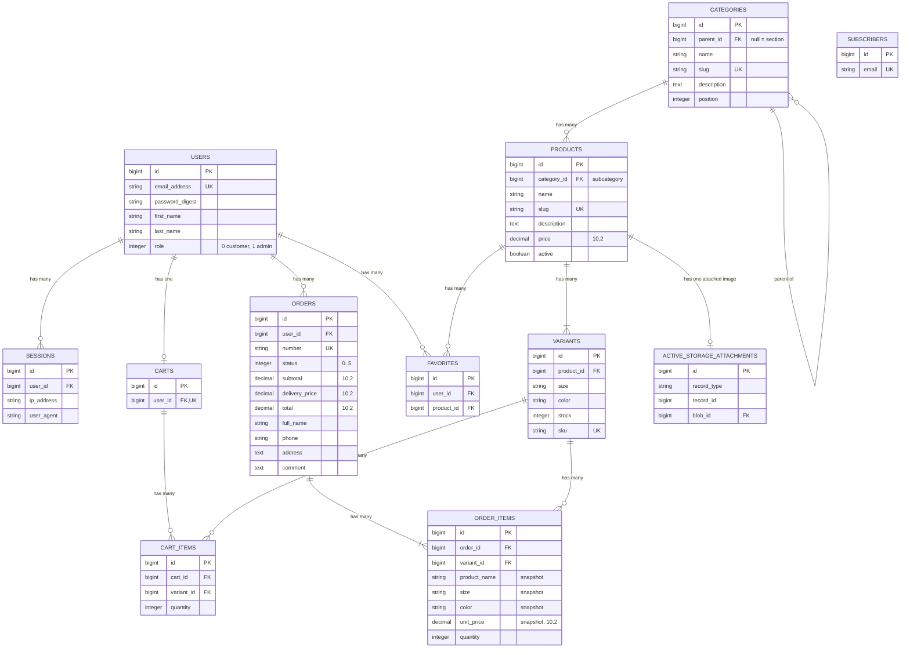
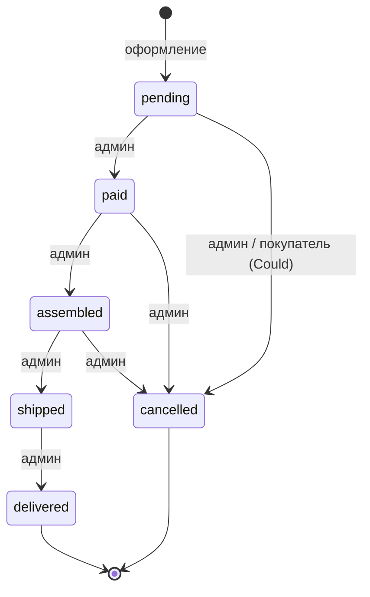

# Структура базы данных (ERD)

> СУБД: PostgreSQL (локально и в CI версия 18). Все таблицы имеют `id bigint` (PK) и `created_at` / `updated_at` (`timestamp`, NOT NULL), если не указано иное.
> Деньги хранятся только в `decimal(10,2)`. Перечисления хранятся в `integer` и описываются через `enum` в модели.
>
> **Ключевые решения модели данных:**
> - Товар (`Product`) описывает модель одежды: название, описание, цену, фото. Конкретная покупаемая единица — **вариант** (`Variant`): размер + цвет + свой остаток + свой артикул. **Остатки хранятся только в `variants.stock`.**
> - Корзина и заказ ссылаются на **вариант** (`variant_id`), а не на товар. В позиции заказа сохраняется снимок названия, размера, цвета и цены.
> - Категории двухуровневые: раздел (Мужское, Женское, Аксессуары) → подкатегория (Куртки, Брюки…). Товар привязывается к подкатегории.
> - Доставка: бесплатно при сумме товаров от 10 000 ₽, иначе 400 ₽. Стоимость доставки фиксируется в заказе.

## 1. Диаграмма



## 2. Таблицы

### 2.1. `users`
Создаётся генератором `bin/rails generate authentication`. Поля `first_name`, `last_name` и `role` добавляются отдельными миграциями.

| Поле | Тип | NULL | Default | Ограничения / индексы |
|---|---|:---:|---|---|
| email_address | string | ✗ | | уникальный индекс |
| password_digest | string | ✗ | | bcrypt |
| first_name | string | ✗ | | |
| last_name | string | ✗ | | |
| role | integer | ✗ | `0` | индекс; check `role IN (0, 1)` |

**Модель `User`:**
- `has_secure_password`
- `has_many :sessions, dependent: :destroy`
- `has_one :cart, dependent: :destroy`
- `has_many :orders, dependent: :restrict_with_error` (пользователя с заказами удалить нельзя)
- `has_many :favorites, dependent: :destroy`
- `has_many :favorite_products, through: :favorites, source: :product`
- `enum :role, { customer: 0, admin: 1 }, default: :customer`
- `normalizes :email_address, with: ->(e) { e.strip.downcase }`
- Валидации: `email_address` — присутствие, формат (`URI::MailTo::EMAIL_REGEXP`), уникальность; `first_name`, `last_name` — присутствие, до 50 символов; `password` — минимум 8 символов (`allow_nil: true` при обновлении).
- Методы:
  - `full_name`
  - `cart!` — возвращает корзину или создаёт её (`cart || create_cart!`)
  - `favorite?(product)`
  - `toggle_favorite!(product)` — добавляет товар в избранное или убирает его оттуда; возвращает `true`, если товар теперь в избранном.

### 2.2. `sessions`
Создаётся генератором аутентификации без изменений: `user_id` (FK, индекс), `ip_address`, `user_agent`. Модель `Session`: `belongs_to :user`.

### 2.3. `categories` — двухуровневое дерево
Первый уровень — **разделы** (`parent_id IS NULL`): Мужское, Женское, Аксессуары. Второй уровень — **подкатегории**: Мужское → Куртки, Брюки, Рубашки…

| Поле | Тип | NULL | Default | Ограничения / индексы |
|---|---|:---:|---|---|
| parent_id | bigint | ✓ | | FK → categories, индекс; check `parent_id <> id` |
| name | string | ✗ | | уникальный индекс `(parent_id, lower(name))` с `NULLS NOT DISTINCT` |
| slug | string | ✗ | | уникальный индекс (глобально) |
| description | text | ✓ | | |
| position | integer | ✗ | `0` | порядок в меню |

> `NULLS NOT DISTINCT` (PostgreSQL 15+, `nulls_not_distinct: true` в Rails) нужен, чтобы два раздела верхнего уровня не могли называться одинаково. Подкатегория «Куртки» может одновременно существовать в «Мужском» и в «Женском».

**Модель `Category`:**
- `belongs_to :parent, class_name: "Category", optional: true, inverse_of: :subcategories`
- `has_many :subcategories, class_name: "Category", foreign_key: :parent_id, dependent: :restrict_with_error, inverse_of: :parent`
- `has_many :products, dependent: :restrict_with_error`
- Валидации:
  - `name` — присутствие, до 100 символов, уникальность в рамках `parent_id` (`case_sensitive: false`);
  - `slug` — присутствие, уникальность, формат `/\A[a-z0-9]+(?:-[a-z0-9]+)*\z/`;
  - **глубина не больше 2:** родитель должен быть разделом (`parent.parent_id.nil?`); категория не может быть родителем самой себе;
  - у раздела, в котором есть подкатегории, нельзя назначить родителя.
- Колбэк `before_validation :generate_slug, if: -> { slug.blank? }`: раздел → `name.parameterize` (`muzhskoe`), подкатегория → `"#{parent.slug}-#{name.parameterize}"` (`muzhskoe-kurtki`). Транслитерация кириллицы задана в `config/locales/ru.yml`.
- `to_param` → `slug`
- Scopes: `sections` → `where(parent_id: nil)`; `ordered` → `order(:position, :name)`.
- Методы:
  - `section?` / `subcategory?`
  - `section` — раздел, к которому относится категория (`parent || self`)
  - `self_and_subcategory_ids` → `[id, *subcategories.ids]`, используется для фильтра каталога: открыть «Мужское» значит показать товары всех его подкатегорий
  - `full_name` → «Мужское › Куртки».

### 2.4. `products` — модель одежды

| Поле | Тип | NULL | Default | Ограничения / индексы |
|---|---|:---:|---|---|
| category_id | bigint | ✗ | | FK → categories (подкатегория), индекс |
| name | string | ✗ | | индекс (сортировка) |
| slug | string | ✗ | | уникальный индекс |
| description | text | ✓ | | описание, состав, уход |
| price | decimal(10,2) | ✗ | `0` | check `price >= 0`; индекс |
| active | boolean | ✗ | `true` | индекс |
| created_at | timestamp | ✗ | | индекс (сортировка «Новинки») |

> Полей `stock` и `sku` у товара **нет**: остаток и артикул принадлежат варианту. Цена общая для всех вариантов товара. Изображение одно на товар (`has_one_attached :image`); фото по цветам и галерея не входят в MVP.

**Модель `Product`:**
- `belongs_to :category`
- `has_many :variants, -> { in_order_of(:size, Variant::SIZES) }, dependent: :destroy, inverse_of: :product`
- `has_many :order_items, through: :variants`
- `has_many :favorites, dependent: :destroy`
- `has_one_attached :image`
- `before_destroy :ensure_not_ordered, prepend: true`. Если хотя бы один вариант есть в заказах, колбэк добавляет ошибку и делает `throw :abort`. Такой товар не удаляется, а скрывается (`active: false`). `prepend: true` нужен, чтобы проверка сработала **до** `dependent: :destroy` у вариантов.
- Варианты в админке управляются отдельным вложенным ресурсом `Admin::VariantsController` (`/admin/products/:product_id/variants`), без `accepts_nested_attributes_for` (см. этап 7 плана).
- Валидации: `name` (до 150 символов), `price` — присутствие; `price` — `numericality >= 0`; `slug` — уникальность и формат; `category` должна быть **подкатегорией**; `image` — тип (`image/jpeg`, `image/png`, `image/webp`) и размер до 5 МБ (собственный валидатор, без гемов).
- Slug генерируется из названия (как у `Category`); `to_param` → `slug`.
- **Scopes каталога** (вся логика фильтрации в модели):

| Scope | Реализация | Примечание |
|---|---|---|
| `active` | `where(active: true)` | |
| `newest` | `order(created_at: :desc)` | |
| `in_category(category)` | `where(category_id: category.self_and_subcategory_ids)` | раздел включает свои подкатегории |
| `search(query)` | `where("products.name ILIKE :q OR products.description ILIKE :q", q: "%#{sanitize_sql_like(query)}%")` | пустой запрос игнорируется |
| `price_from(v)` / `price_to(v)` | `where(price: v..)` / `where(price: ..v)` | некорректные значения игнорируются |
| `in_stock` | `where(id: Variant.in_stock.select(:product_id))` | подзапрос вместо JOIN, чтобы не было дублей |
| `with_size(size)` | `where(id: Variant.in_stock.where(size:).select(:product_id))` | только размеры в наличии |
| `with_color(color)` | `where(id: Variant.where(color:).select(:product_id))` | |
| `sorted_by(key)` | `newest` / `price_asc` / `price_desc` / `name` | неизвестный ключ → `newest` |
| `filter_by(params)` | композиция всех scopes выше | точка входа для контроллера каталога |

- Методы:
  - `in_stock?` → есть вариант с `stock > 0`
  - `available_sizes` → размеры вариантов в наличии, в порядке `Variant::SIZES`
  - `colors` → уникальные цвета вариантов (для подписи в карточке «Чёрный / Табачный»)
  - `section` → `category.parent`.

### 2.5. `variants` — размер и цвет товара *(новая таблица)*

| Поле | Тип | NULL | Default | Ограничения / индексы |
|---|---|:---:|---|---|
| product_id | bigint | ✗ | | FK → products |
| size | string | ✗ | | |
| color | string | ✗ | | |
| stock | integer | ✗ | `0` | check `stock >= 0` |
| sku | string | ✗ | | уникальный индекс (артикул, например `JK-ARD-BLK-M`) |

Уникальный составной индекс `(product_id, size, color)`: одна комбинация размера и цвета — один вариант. Отдельные индексы `size` и `color` нужны для фильтров каталога.

**Модель `Variant`:**
- `SIZES = ["XS", "S", "M", "L", "XL", "XXL", "ONE SIZE"].freeze` — допустимые размеры в порядке отображения. «ONE SIZE» — для аксессуаров. Расширяется по согласованию: например, размеры брюк W30–W36.
- `belongs_to :product, inverse_of: :variants`
- `has_many :cart_items, dependent: :destroy`
- `has_many :order_items, dependent: :restrict_with_error`
- `normalizes :sku, with: ->(s) { s.strip.upcase }`, `normalizes :color, with: ->(c) { c.strip.capitalize }`
- Валидации: `size` — присутствие и `inclusion: { in: SIZES }`; `color` — присутствие, до 50 символов; `stock` — `only_integer, >= 0`; `sku` — присутствие и уникальность; `size` — уникальность в рамках `[product_id, color]`.
- Scopes: `in_stock` → `where("variants.stock > 0")`; `low_stock(limit = 3)` → `where(stock: ...limit)`; `by_size` → `in_order_of(:size, SIZES)`.
- Методы:
  - `available?(quantity = 1)` → `product.active? && stock >= quantity`
  - `label` → «M · Чёрный».

### 2.6. `favorites` — избранное *(новая таблица)*

| Поле | Тип | NULL | Ограничения / индексы |
|---|---|:---:|---|
| user_id | bigint | ✗ | FK → users |
| product_id | bigint | ✗ | FK → products, индекс |

Уникальный индекс `(user_id, product_id)`. В избранное добавляется **товар** (модель), а не вариант: размер выбирается при покупке.

**Модель `Favorite`:** `belongs_to :user`, `belongs_to :product`; валидация уникальности `product_id` в рамках `user_id`.

### 2.7. `subscribers` — подписка на рассылку *(новая таблица)*

| Поле | Тип | NULL | Ограничения / индексы |
|---|---|:---:|---|
| email | string | ✗ | уникальный индекс |

Подписаться может любой посетитель, в том числе гость. Связи с `users` нет. Само отправление писем в MVP не входит, мы только собираем адреса.

**Модель `Subscriber`:**
- `normalizes :email, with: ->(e) { e.strip.downcase }`
- Валидации: `email` — присутствие, формат, уникальность.
- `self.subscribe(email)` → `find_or_create_by(email:)`. Повторная подписка не считается ошибкой. Пользователь в обоих случаях видит одинаковое «Спасибо! Подписка оформлена», чтобы по ответу нельзя было проверить, есть ли адрес в базе.

### 2.8. `carts`
Одна корзина на пользователя: `user_id` (FK, **уникальный** индекс).

**Модель `Cart`:**
- `belongs_to :user`
- `has_many :cart_items, dependent: :destroy`
- `has_many :variants, through: :cart_items`
- Методы:
  - `add_variant(variant, quantity = 1)` — находит или создаёт `CartItem`, увеличивает количество, проверяет `variant.available?(new_quantity)`. Если товара не хватает, возвращает позицию с ошибками.
  - `subtotal` → сумма `quantity * product.price` по позициям
  - `delivery_price` → `Delivery.price_for(subtotal)` (модуль тарифов, см. §2.10)
  - `total` → `subtotal + delivery_price`
  - `amount_to_free_delivery` → `Delivery.amount_to_free(subtotal)`, для подсказки «До бесплатной доставки: … ₽»
  - `items_count` → сумма `quantity` (счётчик в шапке)
  - `empty?`
  - `checkout_ready?` → корзина не пуста и все позиции `available?`
  - `unavailable_items` → позиции, у которых товар скрыт или остатка варианта не хватает.

### 2.9. `cart_items`

| Поле | Тип | NULL | Default | Ограничения / индексы |
|---|---|:---:|---|---|
| cart_id | bigint | ✗ | | FK → carts |
| variant_id | bigint | ✗ | | FK → variants, индекс |
| quantity | integer | ✗ | `1` | check `quantity > 0` |

Уникальный составной индекс `(cart_id, variant_id)`. Один и тот же товар в разных размерах — это **разные** строки корзины.

**Модель `CartItem`:**
- `belongs_to :cart`, `belongs_to :variant`
- `delegate :product, to: :variant`
- Валидации: `quantity` — `only_integer, > 0`; `variant_id` — уникальность в рамках `cart_id`; кастомная проверка `variant.available?(quantity)`.
- Методы: `subtotal` → `quantity * product.price`.
- В корзине показываются фото и название товара, а также размер и цвет варианта (`variant.label`).

### 2.10. `orders`

| Поле | Тип | NULL | Default | Ограничения / индексы |
|---|---|:---:|---|---|
| user_id | bigint | ✗ | | FK → users, индекс |
| number | string | ✗ | | уникальный индекс |
| status | integer | ✗ | `0` | индекс; check `status BETWEEN 0 AND 5` |
| subtotal | decimal(10,2) | ✗ | `0` | сумма товаров; check `>= 0` |
| delivery_price | decimal(10,2) | ✗ | `0` | стоимость доставки на момент заказа; check `>= 0` |
| total | decimal(10,2) | ✗ | `0` | check `total = subtotal + delivery_price` |
| full_name | string | ✗ | | |
| phone | string | ✗ | | |
| address | text | ✗ | | |
| comment | text | ✓ | | |
| created_at | timestamp | ✗ | | индекс (сортировка истории) |

**Тарифы доставки — модуль `Delivery`** (`app/models/delivery.rb`, без таблицы). Им пользуются и `Cart` (этап 13), и `Order` (этап 14):

```ruby
module Delivery
  FREE_FROM = 10_000 # rubles, inclusive
  PRICE     = 400

  def self.price_for(subtotal)
    subtotal >= FREE_FROM ? 0 : PRICE
  end

  def self.amount_to_free(subtotal)
    [ FREE_FROM - subtotal, 0 ].max
  end
end
```

**Модель `Order`:**
- `belongs_to :user`
- `has_many :order_items, dependent: :destroy`
- `enum :status, { pending: 0, paid: 1, assembled: 2, shipped: 3, delivered: 4, cancelled: 5 }, default: :pending`
- Валидации: `full_name` (до 100 символов), `phone`, `address` — присутствие; `phone` — формат `/\A\+?[\d\s\-()]{10,20}\z/`; `number` — уникальность; суммы `>= 0`; в заказе хотя бы одна позиция.
- Колбэк `before_validation :assign_number, on: :create` → `"ORD-#{Date.current.strftime('%Y%m%d')}-#{SecureRandom.hex(2).upcase}"`.
- Scopes: `recent` → `order(created_at: :desc)`; `not_cancelled`; `revenue` → `not_cancelled.sum(:total)`.
- **Бизнес-методы:**
  - `self.place_from_cart!(cart, attributes)` — оформление в транзакции (см. раздел 4)
  - `can_transition_to?(new_status)` и `available_transitions` — по таблице переходов (раздел 3)
  - `transition_to!(new_status)` — смена статуса с проверкой перехода; при `cancelled` вызывает `cancel!`
  - `cancel!` — в транзакции блокирует варианты, возвращает `stock += quantity` и ставит статус `cancelled`
  - `items_count`.

### 2.11. `order_items`

| Поле | Тип | NULL | Ограничения / индексы |
|---|---|:---:|---|
| order_id | bigint | ✗ | FK → orders, индекс |
| variant_id | bigint | ✗ | FK → variants, индекс |
| product_name | string | ✗ | **снимок** названия товара |
| size | string | ✗ | **снимок** размера |
| color | string | ✗ | **снимок** цвета |
| unit_price | decimal(10,2) | ✗ | **снимок** цены; check `unit_price >= 0` |
| quantity | integer | ✗ | check `quantity > 0` |

**Модель `OrderItem`:**
- `belongs_to :order`, `belongs_to :variant`
- `delegate :product, to: :variant`
- Валидации: все снимки и `quantity` — присутствие; числовые ограничения как в БД.
- Методы: `subtotal` → `unit_price * quantity`.

> Название, размер, цвет и цена копируются в позицию. Поэтому переименование товара, изменение цены или цвета варианта в админке не меняют уже оформленные заказы. `variant_id` нужен для ссылки на товар и для возврата остатка при отмене заказа.

### 2.12. Active Storage
Стандартные таблицы `active_storage_blobs`, `active_storage_attachments` и `active_storage_variant_records` (создаются `bin/rails active_storage:install`). Сервис хранения — `local` (`storage/`), в тестах — `test` (`tmp/storage`). Варианты изображений (ресайз) не используются, размеры задаются через CSS (`aspect-[3/4] object-cover`).

## 3. Статусы заказа и переходы



| Текущий статус | Допустимые переходы | Название в UI | Цвет бейджа |
|---|---|---|---|
| `pending` | `paid`, `cancelled` | Новый | серый на светлом (`surface`) |
| `paid` | `assembled`, `cancelled` | Оплачен | чёрный (`ink`) |
| `assembled` | `shipped`, `cancelled` | Собран | табачный (`accent`) |
| `shipped` | `delivered` | Отправлен | табачный (`accent`) |
| `delivered` | — | Доставлен | зелёный (`success`) |
| `cancelled` | — | Отменён | красный (`danger`) |

```ruby
TRANSITIONS = {
  "pending"   => %w[paid cancelled],
  "paid"      => %w[assembled cancelled],
  "assembled" => %w[shipped cancelled],
  "shipped"   => %w[delivered],
  "delivered" => [],
  "cancelled" => []
}.freeze
```

## 4. Транзакция оформления заказа (`Order.place_from_cart!`)

```ruby
# Sketch. Final implementation lands in stage 14.
def self.place_from_cart!(cart, attributes)
  transaction do
    order = cart.user.orders.build(attributes)

    # Lock variants in a fixed order (by id) to avoid deadlocks
    items = cart.cart_items.includes(variant: :product).order(:variant_id)
    raise EmptyCartError if items.empty?

    items.each do |item|
      variant = item.variant.lock!                 # SELECT ... FOR UPDATE
      raise InsufficientStockError.new(variant) unless variant.available?(item.quantity)

      variant.update!(stock: variant.stock - item.quantity)
      order.order_items.build(
        variant:      variant,
        product_name: variant.product.name,
        size:         variant.size,
        color:        variant.color,
        unit_price:   variant.product.price,
        quantity:     item.quantity
      )
    end

    order.subtotal       = order.order_items.sum(&:subtotal)
    order.delivery_price = Delivery.price_for(order.subtotal)
    order.total          = order.subtotal + order.delivery_price
    order.save!
    cart.cart_items.delete_all
    order
  end
end
```

Любое исключение (`InsufficientStockError`, `ActiveRecord::RecordInvalid`) откатывает **всю** транзакцию: остатки вариантов, заказ и корзина остаются как были. Check constraint `variants.stock >= 0` — последний рубеж защиты на уровне БД.

## 5. Политика удаления (`dependent`)

| Связь | Политика | Почему |
|---|---|---|
| User → sessions, cart, favorites | `destroy` | без пользователя не нужны |
| User → orders | `restrict_with_error` | история заказов должна сохраняться |
| Category → subcategories | `restrict_with_error` | нельзя удалить раздел с подкатегориями |
| Category → products | `restrict_with_error` | нельзя оставить товары без категории |
| Product → variants | `destroy` + `before_destroy :ensure_not_ordered` | товар без заказов удаляется вместе с вариантами; товар из заказов только скрывается |
| Product → favorites | `destroy` | удалённый товар исчезает из избранного |
| Variant → cart_items | `destroy` | удалённый вариант исчезает из корзин |
| Variant → order_items | `restrict_with_error` | вариант из заказов не удаляется, его можно обнулить (`stock: 0`) |
| Cart → cart_items | `destroy` | |
| Order → order_items | `destroy` | заказы на практике не удаляются |

## 6. Индексы (сводка)

| Таблица | Индекс | Назначение |
|---|---|---|
| users | `email_address` UNIQUE, `role` | вход, выборка админов |
| categories | `parent_id`; `(parent_id, lower(name))` UNIQUE NULLS NOT DISTINCT; `slug` UNIQUE | дерево, уникальность имён, URL |
| products | `slug` UNIQUE; `category_id`, `active`, `price`, `created_at`, `name` | URL, фильтры и сортировка каталога |
| variants | `(product_id, size, color)` UNIQUE; `sku` UNIQUE; `size`; `color` | без дублей, артикул, фильтры по размеру и цвету |
| favorites | `(user_id, product_id)` UNIQUE; `product_id` | без дублей, FK |
| subscribers | `email` UNIQUE | без дублей |
| carts | `user_id` UNIQUE | одна корзина на пользователя |
| cart_items | `(cart_id, variant_id)` UNIQUE; `variant_id` | без дублей, FK |
| orders | `user_id`, `status`, `created_at`, `number` UNIQUE | ЛК, фильтр в админке, сортировка |
| order_items | `order_id`, `variant_id` | FK |

## 7. Check constraints (сводка)

| Таблица | Ограничение |
|---|---|
| users | `role IN (0, 1)` |
| categories | `parent_id <> id` |
| products | `price >= 0` |
| variants | `stock >= 0` |
| cart_items | `quantity > 0` |
| orders | `status BETWEEN 0 AND 5`, `subtotal >= 0`, `delivery_price >= 0`, `total = subtotal + delivery_price` |
| order_items | `unit_price >= 0`, `quantity > 0` |
